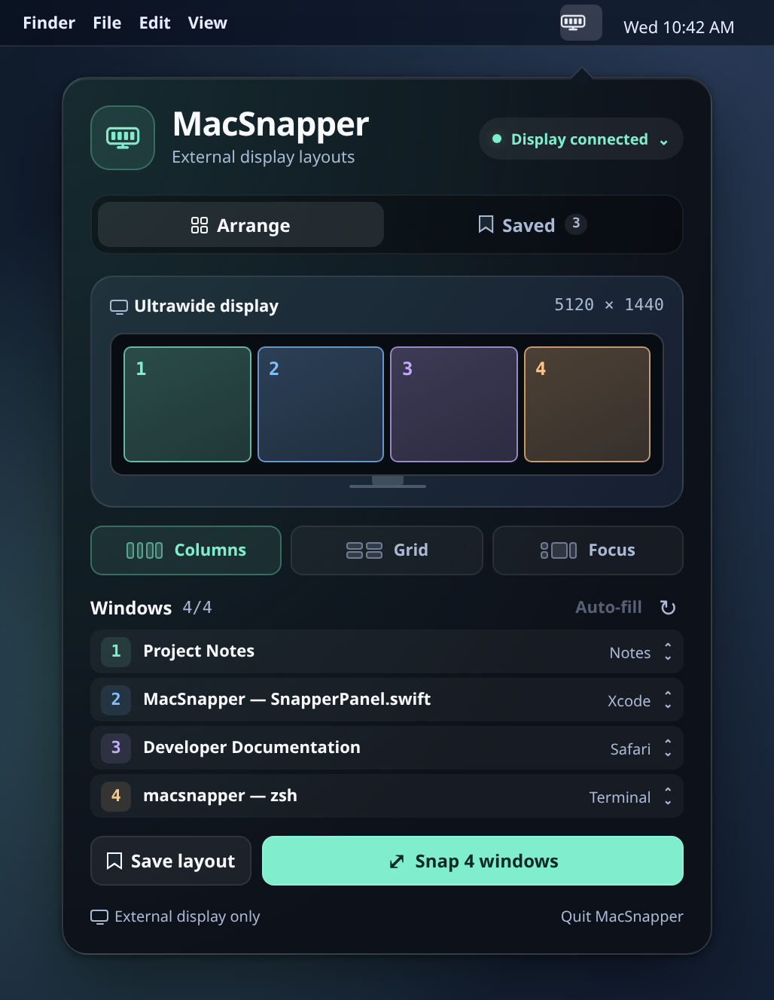

# Windows

Windows is a native macOS 26+ menu bar utility for tiling up to four windows across a 5120 × 1440 ultrawide display in one click. It detects a matching monitor in extended mode and uses its available desktop area, including when macOS display scaling is enabled.



## Install

1. Download `Windows-macOS26.dmg` from the [latest release](https://github.com/BireshwarChakravarty/Windows/releases/latest).
2. Open it and drag **Windows** to **Applications**, then open Windows from Applications.
3. Click **Open Accessibility Settings** in the panel and turn on Windows under **System Settings → Privacy & Security → Accessibility**. If it is missing, use the **+** button there to add it.

Windows runs on macOS 26 or later on Apple silicon and supported Intel Macs. Builds are ad hoc signed, not notarized. If macOS blocks the first launch, follow [Apple’s instructions for opening an app from an unidentified developer](https://support.apple.com/en-us/102445). After updating, remove Windows from the Accessibility list and add it again, because macOS treats each ad hoc signed build as a new app.

## Arrange windows

1. Connect the monitor in extended mode and click the four-column monitor icon in the menu bar. Use the display menu to select your monitor if it is missing from the panel.
2. Put your windows on the monitor and pick a layout. Assign the window for each numbered slot or click **Auto-fill** to fill empty slots from front to back. The monitor preview shows each app in the slot it will fill.
3. Click **Snap** (or press Return). Click **Undo** (or press ⌘Z) to move windows back to where they were before the last snap.
4. Use **Save layout** to name the arrangement, and choose it from **Saved** to restore it later. Windows keeps the current assignments and your saved layouts across launches.

| Layout | Slots | Good for |
| --- | --- | --- |
| Halves | 2 | Two full-height apps side by side |
| Thirds | 3 | Three equal columns |
| Center | 3 | A wide main window between two side panels |
| Columns | 4 | Four equal columns |
| Grid | 4 | Two rows of two |
| Focus | 4 | A wide center window, a tall right column and two stacked windows on the left |

Assignments in slots that a smaller layout hides are kept, so switching back restores them.

Restoration works with open, resizable windows on the selected display in its active desktop Space. If a window is closed or its identity is ambiguous, the slot shows **Missing** until you reopen it or select a replacement. Minimum window sizes may prevent some apps from fitting a slot. The built-in display and mirrored displays are excluded.

## Activity log

Windows records what it does at `~/Library/Logs/Windows/Windows.log`: the displays it sees, the windows it finds, and for every snap each window’s starting frame, target, attempts, errors and final frame. Open it from **Activity log** at the bottom of the panel, where you can also show it in Finder, copy recent entries to paste into a bug report, or clear it. The log rotates at 1 MB and never leaves your Mac.

## Build from source

On a Mac with Xcode 26 or later, open `Windows.xcodeproj` and run the **Windows** scheme, or build the universal app and its disk image from the command line:

```sh
./Scripts/build-app.sh   # writes dist/Windows.app, Windows-macOS26.dmg and Windows-macOS26.zip
open dist/Windows.app
swift test               # layout geometry, window matching and saved layouts (Swift 6.2+, also runs on Linux)
```

Every **Build Windows for macOS** run in the **Actions** tab tests the layout logic, builds the app, and uploads the disk image, the ZIP and renders of the real panel with example data (`Windows --render-previews <directory>`). Pushing a `v*` tag, or running the workflow by hand with a version such as `v1.1.0`, also publishes the disk image and ZIP as a GitHub release with [these notes](.github/release-notes.md). Notarization would need a Developer ID certificate.

| Path | Contents |
| --- | --- |
| `Windows/Core/Arrangement.swift` | Layouts, slot geometry and window matching, shared with the Swift package tests |
| `Windows/Core/Placement.swift` | Rules for judging whether a window reached its slot |
| `Windows/WindowService.swift` | Finding, moving and resizing windows through the Accessibility API |
| `Windows/DisplayTarget.swift` | External display detection and coordinates |
| `Windows/ActivityLog.swift` | The activity log |
| `Windows/AppModel.swift` | App state, saved layouts and Undo |
| `Windows/MenuPanel.swift` | The menu bar panel |
| `Windows/PreviewRenderer.swift` | Renders the panel with example data for design checks |
| `Windows/SnapCheck.swift`, `Scripts/ci/` | End-to-end snapping check that CI runs on a real Mac |
| `Design/AppIcon.svg` | Source for the app icon |

## Previews

These previews show the menu bar panel with example data.

- [Arrange in dark appearance](Previews/Arrange.png)
- [Arrange with the Center layout in light appearance](Previews/Arrange-Light.png)
- [Saved layouts](Previews/Saved.png)
- [Menu bar icon in light and dark appearances](Previews/MenuBarIcon.png)
- [App icon](Previews/AppIcon.png)
